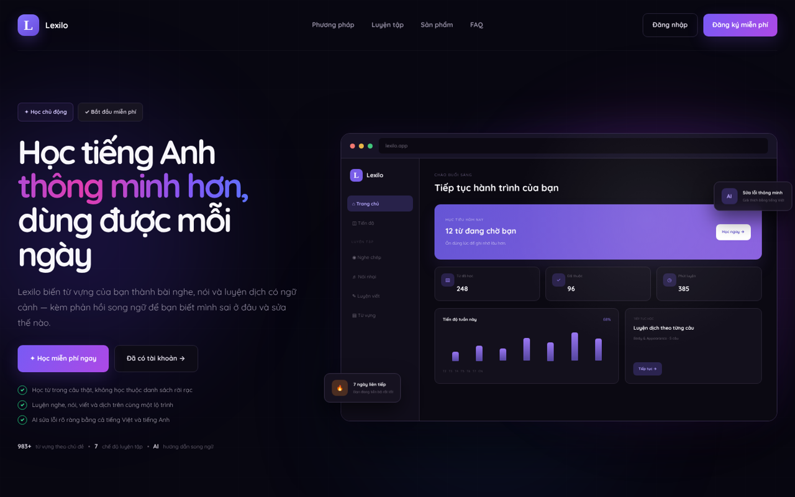

<div align="center">

# 📚 Lexilo (Ryan Voca)

**Website học tiếng Anh thông minh: từ vựng, nghe, nói, viết, có AI chấm và sửa lỗi**

[](https://lexilo.pages.dev)


</div>

---

## 📖 Giới thiệu

Ứng dụng học từ vựng tiếng Anh theo hộp Leitner. Có sẵn bộ **983 từ** chia theo **27 chủ đề** và các chế độ luyện tập kiểu Quizlet, giao diện tiếng Việt. Ngoài từ vựng, app còn có luyện **nói**, **viết** và học qua **video YouTube**. AI chấm bài và giải thích lỗi theo từng câu, đồng thời ghi nhớ các lỗi cũ của người học (RAG) để luyện lại đúng chỗ còn yếu.

Đây là sản phẩm cá nhân và vẫn đang được phát triển tiếp, từ xác định nhu cầu người học, chọn tính năng ưu tiên, thiết kế giao diện đến lập trình, kiểm thử và triển khai.



### Điểm nổi bật

| Nhóm | Tính năng |
|---|---|
| 🧠 **Ôn tập Leitner** | 6 hộp, lịch ôn giãn dần 1/3/7/14/30/90 ngày, 5 kiểu thẻ |
| 🎯 **Luyện tập** | Thẻ ghi nhớ, Học, Kiểm tra, Nối cặp, Nghe – viết, Chép chính tả |
| 🔎 **Tra từ tự động** | Tự điền IPA, nghĩa, định nghĩa Anh–Anh, ví dụ, cụm từ, đồng/trái nghĩa, chủ đề IELTS |
| 🗣️ **Luyện nói & viết** | Nói theo tình huống (AI đóng vai còn lại), viết theo dạng đề thi, AI chấm điểm ước lượng và chỉ ra lỗi |
| 🎬 **Học qua YouTube** | Tiện ích Chrome lấy phụ đề có timestamp để tạo bài nghe chép và nói nhại |
| 🧩 **Ký ức học tập (RAG)** | Gemini Embeddings lưu lỗi cũ theo từng tài khoản để AI cá nhân hóa phản hồi |
| 📈 **Theo dõi tiến độ** | Đếm ngược ngày thi, chuỗi ngày học, bảng xếp hạng, nhắc ôn từ đến hạn |
| 💳 **Gói Premium** | Thanh toán chuyển khoản, tự xác nhận qua webhook ngân hàng |
| ☁️ **Đồng bộ** | Mặc định lưu trên trình duyệt, có thể đồng bộ nhiều thiết bị bằng Supabase |

---

## Chạy thử

```bash
npm install
npm run dev
```

Mở http://localhost:3000. Không cần cấu hình gì — app chạy được ngay ở chế độ lưu
trên máy.

## Chi tiết tính năng

**Ôn tập theo lịch Leitner** — 6 hộp, khoảng cách ôn giãn dần 1/3/7/14/30/90 ngày.
Mỗi thẻ chấm bốn mức Quên / Khó / Được / Dễ, quên thì gặp lại ngay hôm sau.
Phiên ôn có 5 kiểu thẻ đổi được giữa chừng: Việt→Anh, Anh→Việt, trắc nghiệm,
nghe viết, và trộn.

**Luyện tập** — Thẻ ghi nhớ (có đếm thẻ, xáo trộn, tự động phát, theo dõi
đã biết/đang học), Học (chia vòng 7 từ, từ trắc nghiệm lên tự gõ, lưu tiến độ),
Kiểm tra (trộn 4 dạng câu, chấm điểm cuối bài), Nối cặp, Nghe và viết,
Chép chính tả.

**Tổ chức từ vựng** — Từ tự thêm xếp theo ngày học trong tuần; bộ 983 từ chia
theo 27 thư mục chủ đề. Nhập từ Excel hoặc dán danh sách, xuất CSV/Quizlet.

**Tra từ tự động** — Thêm một từ là app tự điền IPA, nghĩa, định nghĩa Anh–Anh,
câu ví dụ kèm bản dịch, cụm nên học, đồng/trái nghĩa và chủ đề IELTS.

**Theo dõi** — Đếm ngược ngày thi, chuỗi ngày học liên tiếp, bảng Leitner theo
nhóm, nhắc ôn các từ đến hạn.

## Dữ liệu

Mặc định mọi thứ lưu trong `localStorage` của trình duyệt. Muốn đồng bộ nhiều
thiết bị thì tạo một dự án Supabase, chạy [`supabase/schema.sql`](supabase/schema.sql)
rồi đặt biến môi trường trong `.env.local`:

```
NEXT_PUBLIC_SUPABASE_URL=...
NEXT_PUBLIC_SUPABASE_PUBLISHABLE_KEY=...
```

### Góp ý của người dùng

Nút **Góp ý** ở thanh trên cùng và cuối Trang chủ ghi vào bảng `feedback`:

1. Chạy [`supabase/feedback.sql`](supabase/feedback.sql) trong Supabase SQL Editor.
2. Đặt `SUPABASE_SERVICE_ROLE_KEY` — route ghi bằng service role để khách chưa
   đăng nhập cũng góp ý được, và để bảng không phải mở quyền đọc cho ai.
3. Đọc lại qua `GET /api/feedback` khi tài khoản nằm trong `ADMIN_EMAILS`.

Chưa cấu hình thì nút vẫn hiện nhưng báo "máy chủ chưa cấu hình để nhận góp ý"
thay vì lỗi trắng màn.

### Ký ức học tập RAG

Để AI truy xuất lỗi dịch cũ và nội dung bài học liên quan theo từng tài khoản:

1. Chạy [`supabase/rag-schema.sql`](supabase/rag-schema.sql) trong Supabase SQL Editor.
2. Đặt `GEMINI_API_KEY`; mặc định app dùng `gemini-embedding-001` với 768 chiều.
3. Có thể kiểm tra trạng thái khi đã đăng nhập qua `GET /api/ai/rag/status`.

RAG có đường lui an toàn: nếu chưa chạy migration hoặc embedding tạm lỗi, chấm bài,
luyện nói và tóm tắt vẫn chạy bằng ngữ cảnh trực tiếp như trước.

Các file dữ liệu dựng sẵn trong `public/`:

| File | Nội dung |
|---|---|
| `vocabulary-1000.json` | 983 từ theo 27 chủ đề |
| `vocabulary-examples.json` | Câu ví dụ riêng cho từng từ kèm bản dịch |
| `vocabulary-enrichment.json` | Định nghĩa, đồng/trái nghĩa, cụm, chủ đề IELTS |
| `usage-details.json` | Ngữ cảnh cho 2484 từ đồng/trái nghĩa |

Sinh lại bằng các script trong `scripts/` (gọi ra từ điển và Datamuse, mất vài phút).

## Lệnh

```bash
npm run dev     # máy chủ phát triển
npm run build   # dựng bản production
npm test        # dựng rồi chạy toàn bộ kiểm thử
npm run lint    # kiểm tra mã
```

## Công nghệ

| Thành phần | Công nghệ |
|---|---|
| Frontend | React 19, TypeScript, Tailwind CSS 4 (không dùng thư viện UI ngoài) |
| Framework / Hosting | [vinext](https://github.com/cloudflare/vinext) trên Cloudflare Workers / Pages |
| Backend & dữ liệu | Supabase (PostgreSQL, Auth, Row Level Security) |
| AI | Gemini (chấm bài, giải thích lỗi), Gemini Embeddings cho RAG, hỗ trợ OpenRouter |
| Tiện ích trình duyệt | Chrome Extension (Manifest V3) lấy phụ đề YouTube |
| Kiểm thử | `node --test`, hơn 50 file kiểm thử |

## Cấu trúc thư mục

```
app/          # Trang và API routes (ai, pay, feedback, youtube, translate, ipa...)
components/   # Màn hình: VocabPractice, SpeakingPractice, WritingPractice, VideoLesson...
lib/          # Nghiệp vụ: Leitner, chấm điểm, phân loại lỗi, đồng bộ, AI guard...
extension/    # Tiện ích Chrome lấy phụ đề YouTube
worker/       # Entry Cloudflare Worker
supabase/     # Các file SQL schema, RLS, RAG, gói Premium
public/       # Bộ dữ liệu từ vựng dựng sẵn
scripts/      # Script sinh lại dữ liệu từ vựng
tests/        # Kiểm thử
```

## 👤 Tác giả

**Trịnh Minh Hiếu** · [GitHub](https://github.com/Hieutrinh04)
